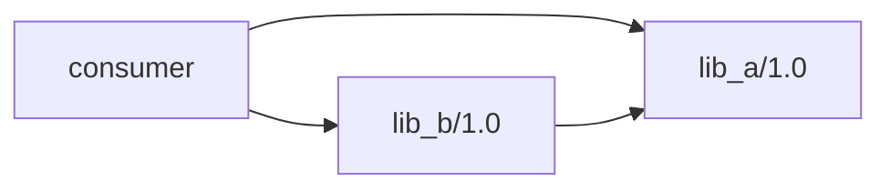

You are solving a software engineering issue in the supplied repository. Inspect the repository, implement the requested production-code change, and run appropriate tests. Do not stop at analysis when a code change is required. Do not search online, inspect repository remotes for the ready-made solution, or access issue/PR pages. Do not modify benchmark tests unless the task explicitly requires test changes. Do not commit, push, reset, or rewrite repository history. Leave the working tree containing your final solution.

Issue:

[bug] order of calls to self.requires changes the inferred requirement traits?

### Describe the bug

conan 2.33.0, windows

The order in which direct/transitive requirements are encountered seems to change the traits (specifically "libs=...") chosen for a ref which is present both as a direct and transitive requirement.

### How to reproduce it

#### lib_a/conanfile.py

```py
from conan import ConanFile

class ConanLibA(ConanFile):
    name = "lib_a"
    version = "1.0"
    package_type = "header-library"
```
`conan export lib_a`

#### lib_b/conanfile.py

```py
from conan import ConanFile

class ConanLibB(ConanFile):
    name = "lib_b"
    version = "1.0"
    package_type = "header-library"
    requires = ("lib_a/1.0")
```
`conan export lib_b`

#### conanfile.txt

And a consumer with a diamond dependency (depends on lib_a both directly and transitively via lib_b)


I get different traits for lib_a depending on the order.

---

```ini
[requires]
lib_b/1.0
lib_a/1.0
```

`conan2 graph info --format json conanfile.txt` > [after.json](https://github.com/user-attachments/files/34046869/after.json)

```json
                    {
                        "ref": "lib_a/1.0",
                        "libs": true,
                        "direct": true,
                    }
```

---

```ini
[requires]
lib_a/1.0
lib_b/1.0
```

`conan2 graph info --format json conanfile.txt` > [before.json](https://github.com/user-attachments/files/34046887/before.json)

```json
                    {
                        "ref": "lib_a/1.0",
                        "libs": false,
                        "direct": true,
                    }
```


---

```ini
[requires]
lib_b/1.0
```

`conan2 graph info --format json conanfile.txt` >  [transitive.json](https://github.com/user-attachments/files/34047238/transitive.json)

```json
                    {
                        "ref": "lib_a/1.0",
                        "libs": false,
                        "direct": false,
                    }
```

---


```ini
[requires]
lib_a/1.0
```

`conan2 graph info --format json conanfile.txt` > [direct.json](https://github.com/user-attachments/files/34047248/direct.json)

```json
                    {
                        "ref": "lib_a/1.0",
                        "libs": false,
                        "direct": true,
                    }
```

I was expecting (both intuitively and per https://docs.conan.io/2/reference/conanfile/methods/requirements.html#package-type-trait-inferring) that `package_type="header-library"` would result in `"libs": false`, and it does in 3 of the 4 cases. But somehow, if a transitive requirement is added first, and then it's later becomes direct, then we get `"libs": true`. This doesn't seem to really hurt much, since a header-library has no libs anyway. But it's weird, and if it's a more general bug in trait inference it might be more important in some other case...

This seems at least similar to #19274 - I noticed it when removing a workaround I'd originally made for that issue, since I was checking the graphs to make sure it order no longer affected the version ranges there...
